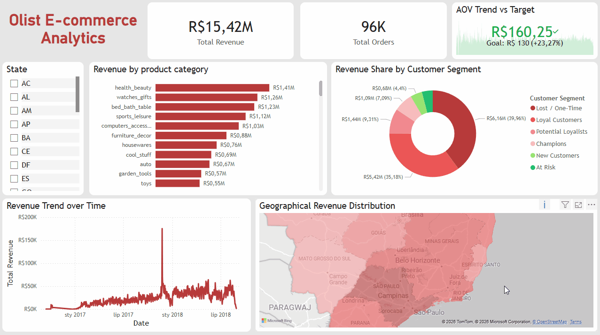

# Olist E-Commerce Sales & Customer Analytics

**An end-to-end analytics project on 96K+ delivered orders: SQL data layer, Python RFM segmentation, unit-tested code, and an interactive Power BI dashboard.**

<p align="center">
  
</p>

<p align="center">
  <strong>96,478 Delivered Orders</strong> &nbsp;•&nbsp;
  <strong>93,358 Customers</strong> &nbsp;•&nbsp;
  <strong>R$15.42M Sales Incl. Freight</strong>
</p>

**Dataset:** [Brazilian E-Commerce Public Dataset by Olist](https://www.kaggle.com/datasets/olistbr/brazilian-ecommerce) (Sep 2016 – Aug 2018)
**Tech Stack:** MySQL 8 · SQL · Python · pandas · NumPy · Jupyter · pytest · Power BI

**Quick links:** [Dashboard (.pbix)](PowerBI/olist%20ecommerce.pbix) · [Dashboard (PDF)](PowerBI/olist%20ecommerce.pdf) · [SQL queries](sql/queries.sql) · [RFM code](python/rfm.py) · [Tests](tests/test_rfm.py)

---

## TL;DR

- **Olist is overwhelmingly a one-time-buyer marketplace.** Only **3.00%** of customers placed a second delivered order, and just **1.55%** qualify as Champions or Loyal Customers.
- **Delivery is slow but mostly reliable.** Average delivery time is **12.5 days**, with an **8.11%** late-delivery rate.
- **Average order value is about R$160** (R$159.83 including freight). Freight adds R$2.20M on top of R$13.22M in product revenue.
- **What I built:** a SQL analytical view, a Python data-quality and RFM pipeline, 20 unit tests, and a Power BI dashboard.

---

## Business Questions

1. **Sales performance:** How do revenue, orders, categories, and states perform?
2. **Retention:** What share of customers come back?
3. **Segmentation:** Which customers are recent, valuable, or at risk (RFM)?
4. **Delivery:** How long do orders take, and how often are they late?

---

## Key Findings

| Area | Result |
|---|---|
| Delivered orders / customers | 96,478 / 93,358 |
| Product revenue | R$13.22M |
| Freight | R$2.20M |
| Sales incl. freight | R$15.42M |
| Average order value (incl. freight) | R$159.83 |
| Repeat-customer rate | 3.00% (2,801 customers) |
| Average delivery time | 12.50 days |
| Late-delivery rate | 8.11% (96,470 eligible orders) |

**Retention is the core story.** Fewer than 1 in 30 customers reorder, so growth depends heavily on acquiring new buyers. That makes repeat-purchase behaviour the most valuable area to study next.

**Customer segments (RFM):**

| Segment | Customers | Share |
|---|---:|---:|
| Lost / One-Time | 45,420 | 48.65% |
| New Customers | 22,760 | 24.38% |
| Potential Loyalists | 22,470 | 24.07% |
| At Risk | 1,258 | 1.35% |
| Loyal Customers | 864 | 0.93% |
| Champions | 586 | 0.63% |

> **Note:** Segments are rule-based and meant for exploration, not churn prediction. Because the dataset spans only two years, many "Lost / One-Time" customers are simply single buyers whose window to return was short.

---

## Recommended Next Steps

Each next step comes with a success metric so the impact can be measured rather than assumed.

| Focus | Proposed analysis | Success metric |
|---|---|---|
| **Retention** | Build monthly customer cohorts; test targeted follow-ups for first-time buyers | % of first-time customers who reorder within 90 days |
| **Delivery reliability** | Compare late rates and delivery times by customer state and seller | Late-delivery rate and avg. delivery time by region |
| **Customer experience** | Compare review scores for on-time vs. late orders | Avg. review score and % low-rated reviews by delivery status |
| **Freight economics** | Compare freight to product revenue by category and state | Freight-to-product-revenue ratio |

---

## Power BI Dashboard

Interactive report covering:

- Executive KPI cards (revenue, order volume)
- AOV trend vs. target
- Revenue by product category
- Revenue by RFM segment
- Revenue over time
- State-level revenue map with filtering

Files: [`.pbix` report](PowerBI/olist%20ecommerce.pbix) · [PDF export](PowerBI/olist%20ecommerce.pdf)

---

## Skills Demonstrated

- **SQL:** multi-table joins, analytical view design, grain control (`COUNT(DISTINCT order_id)`), KPI and trend queries, indexing
- **Python:** pandas / NumPy processing, data-quality checks, RFM scoring and segmentation
- **Testing:** 20 pytest unit tests on synthetic data (frequency, recency, monetary, quartile ties, segment rules, data-quality flags)
- **BI & communication:** Power BI dashboard, metric definitions, business-oriented recommendations

---

## Technical Implementation

### SQL (MySQL)

- Built `vw_master_sales`, an order-item-grain view of delivered orders joining orders, customers, order items, products, and category translations.
- Used `COUNT(DISTINCT order_id)` for order-level metrics so multi-item orders are not double-counted.
- Wrote 8 analytical queries: headline KPIs, grain checks, monthly trends, categories, state sales, repeat purchasing, delivery performance, and customer segments.

Files: `sql/db_create.sql`, `sql/fact_table.sql`, `sql/queries.sql`, `sql/indexes.sql`

### Python

- Loaded the Olist CSVs into MySQL via a Jupyter workflow.
- Checked for missing keys, unparseable dates, negative values, duplicate `(order_id, order_item_id)` keys, and missing prices or freight.
- Calculated customer-level RFM metrics and assigned segments.

Files: `python/notebook.ipynb`, `python/rfm.py`, `python/config.py`

### RFM Definitions

- **Recency:** days since last purchase, measured from one day after the latest purchase in the data
- **Frequency:** number of distinct delivered orders
- **Monetary:** total product price plus freight

Recency and monetary use quartile scoring (ties share a score); frequency is scored on distinct delivered orders. Segment rules are in `python/rfm.py`.

---

<details>
<summary><strong>Setup and Execution</strong></summary>

### Prerequisites

- Python 3.10+
- MySQL 8
- Git
- Power BI Desktop (optional)

### 1. Clone and install

```bash
git clone https://github.com/RonakGoyal11/Ecommerce-Sales-Analytics.git
cd Ecommerce-Sales-Analytics
python -m venv .venv
```

Activate the environment:

- **Windows:** `.venv\Scripts\activate`
- **macOS/Linux:** `source .venv/bin/activate`

```bash
python -m pip install -r requirements.txt
```

### 2. Download the dataset

Download the [Olist dataset from Kaggle](https://www.kaggle.com/datasets/olistbr/brazilian-ecommerce) and extract the nine CSV files listed in `EXPECTED_CSV_FILES` (`python/config.py`) into `data/raw/`, or set `OLIST_DATA_DIR` to another folder.

### 3. Configure MySQL

Copy `.env.example` to `.env` and update it:

```dotenv
DB_HOST=localhost
DB_PORT=3306
DB_USER=root
DB_PASSWORD=your_mysql_password
DB_NAME=olist_ecommerce
OLIST_DATA_DIR=data/raw
```

Never commit `.env`.

### 4. Create the database and run the notebook

```bash
mysql -u root -p < sql/db_create.sql
jupyter notebook python/notebook.ipynb
```

Run the cells in order to load data, create the view, run quality checks, and calculate RFM segments.

> **Warning:** The loading cell uses `if_exists="replace"`, which overwrites existing source tables. Confirm `DB_NAME` before running.

### 5. Run SQL and tests

Run `sql/queries.sql` in your MySQL client (the segment summary needs the `customer_segments` table created by the notebook). Optionally apply `sql/indexes.sql` once.

```bash
python -m pytest tests -q
```

### 6. Open the dashboard

Open `PowerBI/olist ecommerce.pbix` in Power BI Desktop, point the data source to your local MySQL database, and refresh.

</details>

<details>
<summary><strong>Repository Structure</strong></summary>

```text
Ecommerce-Sales-Analytics/
├── data/raw/                      # Local Olist CSVs (git-ignored)
├── PowerBI/
│   ├── dashboard_preview.gif
│   ├── olist ecommerce.pbix
│   └── olist ecommerce.pdf
├── python/
│   ├── config.py
│   ├── notebook.ipynb
│   └── rfm.py
├── reports/validated_business_metrics.csv
├── sql/
│   ├── db_create.sql
│   ├── fact_table.sql
│   ├── indexes.sql
│   └── queries.sql
├── tests/test_rfm.py
├── .env.example
├── LICENSE
├── README.md
└── requirements.txt
```

</details>

<details>
<summary><strong>Scope and Methodology</strong></summary>

- **Period:** September 2016 – August 2018
- **Order scope:** headline sales metrics cover delivered orders only
- **Grain:** each row in the sales view is an order item; order-level counts use distinct order IDs
- **Delivery metrics:** only orders with purchase, delivery, and estimated-delivery timestamps
- **AOV:** sales including freight divided by distinct delivered orders
- **RFM:** rule-based segments for exploratory analysis

</details>

---

## Attribution and Licensing

**Dataset:** [Brazilian E-Commerce Public Dataset by Olist](https://www.kaggle.com/datasets/olistbr/brazilian-ecommerce) on Kaggle. Not redistributed here; see the publisher's terms before reuse.

**Code:** MIT License (see [`LICENSE`](LICENSE)). This does not cover the Olist dataset or third-party content, including map data credited in the dashboard.

This is an independent portfolio project and is not affiliated with or endorsed by Olist.

**Author:** [Ronak Goyal](https://github.com/RonakGoyal11)