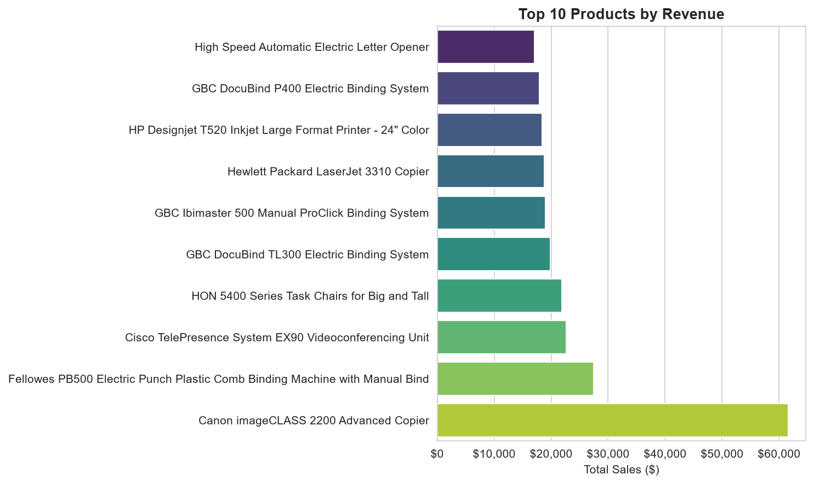
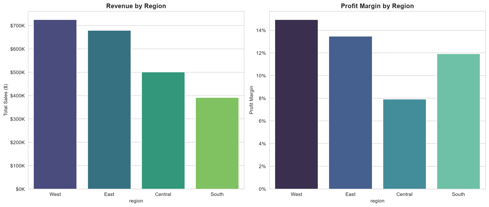
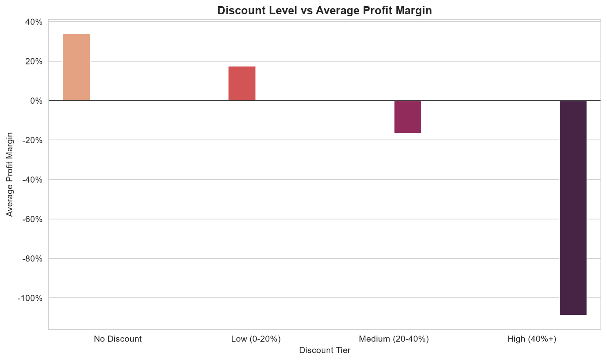
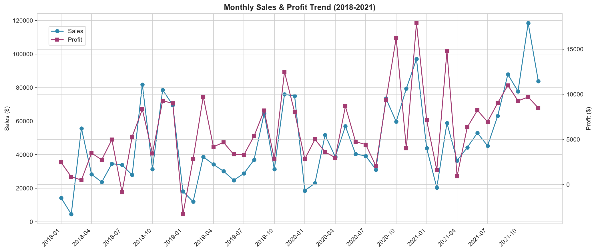

# E-Commerce Sales & Customer Analytics Dashboard

An end-to-end Business Analytics project on the Tableau Sample Superstore dataset — Python ETL, MySQL analytics, Power BI executive dashboard, and a written business-insights report, built the way an analytics function inside a real e-commerce company would build it.


---

## Table of Contents

1. [Project Overview](#project-overview)
2. [Business Problem](#business-problem)
3. [Objectives](#objectives)
4. [Dataset](#dataset)
5. [Folder Structure](#folder-structure)
6. [Tech Stack](#tech-stack)
7. [Methodology](#methodology)
8. [Data Cleaning](#data-cleaning)
9. [Exploratory Data Analysis](#exploratory-data-analysis)
10. [SQL Analysis](#sql-analysis)
11. [Power BI Dashboard](#power-bi-dashboard)
12. [Business Insights](#business-insights)
13. [Recommendations](#recommendations)
14. [Installation](#installation)
15. [Execution](#execution)
16. [Screenshots](#screenshots)
17. [Future Scope](#future-scope)

---

## Project Overview

This project analyzes ~10,000 order line items from the Tableau Sample Superstore dataset to diagnose **why a $2.3M-revenue retail business only converts 12.5% of that into profit**, and to build the tooling — a cleaned data pipeline, a MySQL analytics layer, and a Power BI executive dashboard — that a Business/Data Analyst would hand to leadership to fix it.

## Business Problem

Superstore's leadership can see top-line revenue, but not **where profit is being made or lost**. Discounting is applied inconsistently, some product lines and regions are chronically unprofitable, and there's no systematic view of customer value or churn risk. The business needs an analytics layer that turns raw order data into specific, actionable recommendations.

## Objectives

- Clean and validate the raw Superstore data end-to-end with a documented audit trail
- Engineer time, profitability, and customer/product features for analysis
- Answer core business questions: top/bottom products, regional and category performance, monthly seasonality, discount impact, and executive KPIs
- Write 30-40 interview-quality SQL queries covering the full analytical SQL toolkit
- Design a Power BI executive dashboard with DAX measures for company-wide reporting
- Translate every analysis into a business insight with a concrete recommendation

## Dataset

**Source:** Tableau Sample Superstore (uploaded `.xls` workbook, used as-is — no synthetic data).

| Sheet | Rows | Description |
|---|---|---|
| `Orders` | 9,994 | One row per order line item — dates, customer, product, sales, profit |
| `People` | 4 | Regional Manager per Region |
| `Returns` | 800 | Order IDs that were returned |

**Verified facts about this dataset** (from the audit in `src/data_loader.py`):
- 9,994 rows × 21 columns in `Orders`, spanning **2018-01-03 to 2021-12-30**
- **Zero duplicate rows**, zero duplicate `Row ID`s
- **11 missing values**, all `Postal Code`, all for Burlington, Vermont — resolved via city/state lookup (ZIP 05401) in `data_cleaning.py`
- 5,009 unique orders, 793 unique customers, 1,862 unique products

## Folder Structure

```
Ecommerce-Sales-Analytics/
│
├── data/
│   ├── raw/                     # Original Sample_Superstore.xls
│   └── processed/                # Cleaned CSV + summary tables
│
├── src/                          # Modular Python pipeline
│   ├── config.py                 # Paths, thresholds, style constants
│   ├── utils.py                  # Logging, formatting helpers
│   ├── data_loader.py             # Read raw workbook + audit
│   ├── data_cleaning.py           # Clean, validate, merge reference data
│   ├── feature_engineering.py     # Time, profitability, RFM-style features
│   ├── eda.py                     # Business-question analysis functions
│   ├── visualization.py           # Chart generation (matplotlib/seaborn)
│   ├── business_insights.py       # Narrative insight generation
│   ├── export_data.py             # Persist processed CSVs
│   └── main.py                    # End-to-end pipeline entry point
│
├── notebooks/                    # (reserved for exploratory notebooks)
├── sql/
│   ├── 01_schema.sql              # MySQL 8 schema (orders, regional_managers, returns)
│   └── 02_business_queries.sql    # 40 interview-quality queries
│
├── dashboard/
│   └── PowerBI_Build_Guide.md     # Data model, DAX measures, page layout
│
├── images/                       # 9 generated charts (PNG)
├── reports/
│   └── business_insights.md       # 30 What/Why/Impact/Recommendation insights
│
├── presentation/
│   ├── project_presentation.pptx  # 15-slide project deck
│   ├── architecture.png
│   ├── workflow.png
│   ├── dashboard_mockup.png
│   └── build_deck.js
│
├── README.md
├── requirements.txt
├── .gitignore
└── LICENSE
```

## Tech Stack

| Layer | Tools |
|---|---|
| Language | Python 3.12 |
| Data manipulation | pandas, NumPy |
| Visualization | Matplotlib, Seaborn |
| Database | MySQL 8 |
| BI / Dashboard | Power BI (DAX) |
| Version control | Git, GitHub |

## Methodology

The pipeline follows a standard analytics-engineering sequence, each stage a standalone Python module (no notebook-only logic):

`Load & Audit → Clean & Merge → Feature Engineering → EDA → Export → Visualize → Insights`

Run the whole thing with one command: `python -m src.main` (see [Execution](#execution)).

## Data Cleaning

Performed in `src/data_cleaning.py`:

1. Standardized all column names to `snake_case`
2. Enforced correct dtypes (dates parsed, categoricals typed)
3. Resolved the 11 missing `Postal Code` values via city/state lookup (documented, not silently dropped)
4. Removed exact duplicate rows (defensive — none were found)
5. Merged in `Regional Manager` from the People sheet and `Returned` status from the Returns sheet
6. Trimmed whitespace on every text column
7. Validated business-rule ranges (discount within [0,1], quantity > 0, sales > 0)

## Exploratory Data Analysis

`src/eda.py` answers each required business question as a reusable function returning a tidy DataFrame:

- `executive_kpis` — headline KPI table
- `top_selling_products` / `lowest_profit_products`
- `customer_analysis` — top customers by lifetime value
- `regional_analysis` / `category_analysis`
- `monthly_trend` — with month-over-month growth
- `discount_impact` — profit margin by discount tier
- `profitability_by_segment` — segment × ship mode
- `return_rate_by_category`

### Executive KPIs (computed from the cleaned dataset)

| KPI | Value |
|---|---|
| Total Revenue | $2,297,200.86 |
| Total Profit | $286,397.02 |
| Overall Profit Margin | 12.47% |
| Total Orders | 5,009 |
| Total Customers | 793 |
| Total Products Sold | 1,862 |
| Average Order Value | $458.61 |
| Average Discount | 15.62% |
| Return Rate | 8.00% |
| Loss-Making Order Lines | 19.37% |

## SQL Analysis

`sql/02_business_queries.sql` contains **40 interview-quality queries** organized by technique, each with a stated business purpose:

- **Section A** — Foundational aggregation (`GROUP BY`, `HAVING`)
- **Section B** — Conditional logic (`CASE WHEN`)
- **Section C** — Common Table Expressions (CTEs)
- **Section D** — Window functions, ranking, running totals, moving averages
- **Section E** — Subqueries (correlated and non-correlated)
- **Section F** — Multi-table joins (People / Returns integration)
- **Section G** — Time-based / cohort-style analysis
- **Section H** — Reusable views (`vw_executive_kpis`, `vw_customer_360`, `vw_monthly_performance`)
- **Section I** — Indexes for query performance
- **Section J** — `EXPLAIN`-based query tuning

Schema is in `sql/01_schema.sql`. Core query logic was verified against a SQLite stand-in loaded with the actual cleaned data before being finalized for MySQL 8 syntax.

## Power BI Dashboard

Since Power BI Desktop is a Windows GUI application, `dashboard/PowerBI_Build_Guide.md` provides everything needed to assemble the live `.pbix` in under an hour:

- Full data model (fact table + date table + relationships)
- **16 copy-paste-ready DAX measures** (Total Revenue, Profit Margin %, MoM Growth, YoY Growth, Running Total, RANKX-based Top Customer, etc.)
- 4-page report layout: Executive Overview, Customer Analysis, Product & Category Analysis, Regional & Discount Analysis
- Interactivity checklist (synced slicers, drillthrough, bookmarks) and a custom color theme

See `presentation/dashboard_mockup.png` for the visual target.

## Business Insights

`reports/business_insights.md` contains **30 insights**, each following the **What Happened → Why → Business Impact → Recommendation** framework, computed live from the cleaned data (nothing fabricated). Highlights:

1. Orders discounted 40%+ average a **-109% profit margin** — every one is a loss
2. Furniture (Tables, Bookcases) is the largest profit drain in the catalog
3. Technology (Copiers, Accessories) is the strongest margin performer
4. The top spend quartile ("Platinum" tier) drives a disproportionate share of revenue
5. A measurable share of customers are inactive 180+ days and at churn risk

## Recommendations

1. **Cap discounts at 20%** for standard orders; require finance sign-off above that
2. **Re-price or delist** chronically loss-making SKUs in Tables and Bookcases
3. **Prioritize Technology** (Copiers, Accessories) in marketing and inventory investment
4. **Launch a win-back campaign** triggered at 90 days of customer inactivity
5. **Move budgeting to quarterly, seasonally-indexed targets** instead of flat monthly assumptions

## Installation

```bash
git clone https://github.com/RonakGoyal11/Ecommerce-Sales-Analytics.git
cd Ecommerce-Sales-Analytics
python -m venv venv
source venv/bin/activate        # Windows: venv\Scripts\activate
pip install -r requirements.txt
```

## Execution

```bash
# Run the full pipeline: load -> clean -> feature engineer -> EDA -> export -> visualize -> insights
python -m src.main
```

This regenerates:
- `data/processed/*.csv` (cleaned dataset + 4 summary tables)
- `images/*.png` (9 charts)
- `reports/business_insights.md` (30 insights)

For SQL, load `sql/01_schema.sql` then `sql/02_business_queries.sql` into a MySQL 8 instance (adjust the `LOAD DATA INFILE` path in `01_schema.sql` to your local `data/processed/superstore_cleaned.csv`).

## Screenshots

| Top Selling Products | Regional Performance |
|---|---|
|  |  |

| Discount Impact on Margin | Monthly Trend |
|---|---|
|  |  |

Full Power BI dashboard mockup: [`presentation/dashboard_mockup.png`](presentation/dashboard_mockup.png)

## Future Scope

- Connect Power BI directly to a live MySQL instance (DirectQuery) instead of static CSVs
- Add a forecasting module (e.g. Prophet or ARIMA) for next-quarter revenue projection
- Build a customer-churn classification model on top of the existing RFM features
- Automate the pipeline with GitHub Actions to re-run on new data drops
- Add row-level security in Power BI so each Regional Manager sees only their region

---

## Author

Built as a portfolio-grade Business/Data Analyst project.

For the complete presentation, see the `presentation/` folder.
